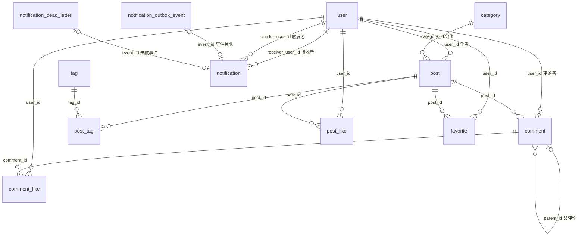

# 数据库表结构与设计说明

本文根据当前仓库的 MySQL 建表脚本、后续变更脚本和相关服务代码整理，帮助新成员理解每张表保存什么、表之间如何关联，以及部分字段为什么要冗余保存。这里描述的是**执行完全部现有 SQL 变更后的目标结构**，不是某个线上数据库的实时快照。

## 1. 数据库概览

核对日期：2026-10-10。本文与 [Redis 缓存说明](REDIS_CACHE.md) 配套阅读。

初始化数据库名为 `forum`，业务表使用 InnoDB、`utf8mb4` 和 `utf8mb4_unicode_ci`；V8 新表只显式指定 InnoDB，字符集与排序规则继承实际数据库默认值。原有 13 张业务表，V8 增加 3 张异步互动支撑表，合计 16 张（不包含 Flyway 的 `flyway_schema_history`）：

| 模块 | 表 | 作用 |
| --- | --- | --- |
| 账号 | `user` | 用户身份、资料、角色及状态 |
| 内容 | `category`、`post`、`tag`、`post_tag` | 分类、帖子、标签及帖子与标签的多对多关系 |
| 互动 | `comment`、`post_like`、`comment_like`、`favorite` | 评论、点赞和收藏的明细 |
| 通知 | `notification`、`notification_outbox_event`、`notification_dead_letter` | 用户可见通知、待发送事件及消费失败记录 |
| 审计 | `operation_log` | 操作记录 |
| 异步互动 | `interaction_event`、`interaction_projection`、`interaction_worker_lock` | 持久化变化、派生任务、后台实例协调 |

以下箭头表示**业务上的 ID 引用**。当前 SQL **没有声明 `FOREIGN KEY` 约束**，因此箭头不代表数据库会自动阻止孤儿记录或级联删除。



`notification_outbox_event` 和 `notification_dead_letter` 不保证与 `notification` 一一存在：前者可能尚未消费，后者只在消费失败时出现。它们通过 `event_id` 识别同一个事件。

## 2. 账号与内容

### `user`：用户

| 字段 | 含义 |
| --- | --- |
| `id` | `BIGINT` 自增主键 |
| `username`、`email` | 登录/识别信息；各有唯一索引 `uk_username`、`uk_email` |
| `password` | BCrypt 密码哈希，`VARCHAR(255)`；不保存明文 |
| `nickname`、`avatar`、`bio` | 昵称、头像 URL、个人简介，可为空 |
| `role` | `0` 普通用户，`1` 管理员；默认 `0` |
| `status` | `0` 禁用，`1` 正常；默认 `1` |
| `post_count` | 用户发帖数的冗余计数，默认 `0` |
| `created_at`、`updated_at` | 注册、更新时间；后者由 MySQL 在更新时自动刷新 |

### `category`：帖子分类

| 字段 | 含义 |
| --- | --- |
| `id` | `BIGINT` 自增主键 |
| `name` | 分类名；唯一索引 `uk_name` |
| `description`、`icon` | 描述及图标，可为空 |
| `sort_order` | 展示排序号，默认 `0` |
| `post_count` | 分类下帖子数的冗余计数，默认 `0` |
| `created_at` | 创建时间 |

`init.sql` 会初始化“技术讨论”“问答求助”“灌水区”三个分类，并利用分类名的唯一索引避免重复插入。

### `post`：帖子主体

| 字段 | 含义 |
| --- | --- |
| `id` | `BIGINT` 自增主键 |
| `title`、`content` | 标题 `VARCHAR(200)`、HTML 正文 `LONGTEXT`，均不可为空 |
| `summary`、`cover_image` | 可空摘要；封面图 URL 不可为空 |
| `user_id`、`category_id` | 作者与所属分类；分别有 `idx_user_id`、`idx_category_id` 索引 |
| `location_name`、`address`、`place_id` | 可空的地区名称、精确地址、地图地点 ID |
| `latitude`、`longitude` | 可空经纬度，均为 `DECIMAL(9,6)`；有组合索引 `idx_location(latitude, longitude)` |
| `view_count` | 浏览计数，默认 `0` |
| `like_count`、`comment_count`、`favorite_count` | 点赞、评论、收藏的冗余计数，默认 `0` |
| `is_top`、`is_essence` | 置顶、精华标记，默认 `0` |
| `status` | `0` 待审核，`1` 正常，`2` 隐藏；默认 `1` |
| `created_at`、`updated_at` | 发帖、更新时间 |

`idx_post_hot_listing(status, is_top, category_id, created_at)` 为近 24 小时全站/分类热榜的数据库筛选提供索引支持。帖子只存一个 `category_id`；多个标签通过 `post_tag` 表表达。

### `tag` 与 `post_tag`：标签及多对多关系

| 表 | 字段 | 含义及约束 |
| --- | --- | --- |
| `tag` | `id`、`name`、`post_count`、`created_at` | 标签 ID 为自增主键；`name` 唯一，最长 30 字符；`post_count` 是使用次数的冗余计数 |
| `post_tag` | `post_id`、`tag_id` | 联合主键 `(post_id, tag_id)`，使同一帖子不能重复关联同一标签 |

例如一个帖子关联“Java”和“MySQL”两个标签，`post` 只有一行，`post_tag` 有两行。`post_tag` 当前没有单独的 `tag_id` 索引；如果按标签反查帖子成为高频查询，应结合实际查询计划评估索引。

## 3. 评论与互动

### `comment`：帖子评论和回复

| 字段 | 含义 |
| --- | --- |
| `id`、`content` | 自增主键、`TEXT` 评论正文 |
| `user_id`、`post_id` | 评论者及所属帖子；分别有索引 |
| `parent_id` | 父评论 ID；`NULL` 表示一级评论，有索引 `idx_parent_id` |
| `reply_to_user_id` | 回复目标用户 ID，可为空 |
| `like_count` | 评论点赞数的冗余计数，默认 `0` |
| `status` | `0` 隐藏，`1` 正常；默认 `1` |
| `created_at` | 评论时间 |

`idx_comment_user_status_created(user_id, status, created_at)` 用于按用户、状态和时间读取历史评论，例如重建近期兴趣画像。`parent_id` 表达评论层级，`reply_to_user_id` 表达这条回复面向谁，两者用途不同。

### `post_like`、`comment_like`、`favorite`：互动关系明细

| 表 | 字段 | 联合主键 | 表达的事实 |
| --- | --- | --- | --- |
| `post_like` | `user_id`、`post_id`、`created_at` | `(user_id, post_id)` | 某用户当前点赞某帖子 |
| `comment_like` | `user_id`、`comment_id`、`created_at` | `(user_id, comment_id)` | 某用户当前点赞某评论 |
| `favorite` | `user_id`、`post_id`、`created_at` | `(user_id, post_id)` | 某用户当前收藏某帖子 |

一条关系存在表示当前处于点赞/收藏状态；撤销时删除相应关系。联合主键防止同一用户对同一对象重复记录。`post_like` 另有 `idx_post_like_user_created(user_id, created_at)`，`favorite` 另有 `idx_favorite_user_created(user_id, created_at)`，便于按用户和时间读取近期互动，供兴趣画像重建使用。`created_at` 是**当前这条关系的创建时间**，不是完整的互动历史。

### `interaction_event`：已提交的个人状态变化（V8）

| 字段 | 类型、默认值与含义 |
| --- | --- |
| `id` | `BIGINT` 自增主键；后台按 ID 顺序扫描 |
| `event_id` | `VARCHAR(36) NOT NULL UNIQUE`；请求生成的 UUID |
| `kind` | `VARCHAR(20) NOT NULL`；`post_like`、`favorite`、`comment_like` |
| `user_id`、`target_id`、`post_id` | `BIGINT NOT NULL`；操作人、互动目标、所属帖子；评论点赞的目标是评论 ID，其他两类目标是帖子 ID |
| `receiver_id` | 可空 `BIGINT`；请求时记录的帖子/评论作者，供后台生成通知 |
| `active` | `BOOLEAN NOT NULL`；本次变化后的状态，不代表处理时关系仍存在 |
| `created_at` | `DATETIME(6) NOT NULL`，默认当前时间；事件产生时间 |
| `processed_at` | 可空 `DATETIME(6)`；`NULL` 表示尚未完成数据库阶段，非空不表示 Redis 或通知消费完成 |
| `attempts` | `INT NOT NULL DEFAULT 0`；处理失败累计次数 |
| `next_retry_at` | `DATETIME(6) NOT NULL`，默认当前时间；到期后允许处理 |
| `last_error` | 可空 `VARCHAR(1000)`；最近错误，成功后清空 |

索引 `ix_interaction_pending(processed_at, next_retry_at, id)` 支持待处理扫描。明确设置个人状态时，关系变化与事件插入在同一短事务提交；重复设置相同状态不新增事件。请求不更新点赞/收藏总数，也不访问 Redis/Kafka。

### `interaction_projection`：合并后的派生任务（V8）

| 字段 | 类型、默认值与含义 |
| --- | --- |
| `kind`、`target_id` | `VARCHAR(10) NOT NULL`、`BIGINT NOT NULL`；联合主键 `(kind, target_id)`；`POST` 指帖子详情失效和热榜刷新，`USER` 指用户兴趣画像重建 |
| `revision` | `BIGINT NOT NULL DEFAULT 1`；同一目标再次登记时递增 |
| `completed_revision` | `BIGINT NOT NULL DEFAULT 0`；最近成功完成的修订号 |
| `previous_category_id` | 可空 `BIGINT`；旧分类清理提示；热榜还扫描 Redis 注册表以清理多次改分类留下的成员 |
| `pending` | `BOOLEAN NOT NULL DEFAULT TRUE`；是否存在待处理任务 |
| `created_at` | `DATETIME(6) NOT NULL`，默认当前时间；新任务的排队时间；已完成任务重新登记时刷新，积压期间合并不刷新 |
| `attempts` | `INT NOT NULL DEFAULT 0`；失败次数；重新登记或成功完成时归零 |
| `next_retry_at` | `DATETIME(6) NOT NULL`，默认当前时间；到期后允许执行 |
| `last_error` | 可空 `VARCHAR(1000)`；最近错误；重新登记或成功完成时清空 |

索引 `ix_projection_pending(pending, next_retry_at)` 支持扫描。任务执行期间持有任务行锁，完成时写入 `completed_revision`、清除 `pending` 和旧分类提示；后续登记在锁释放后递增版本。**完成后保留任务行**，以维持画像版本连续，不能把它当成处理完就删除的临时队列。登记入口见 [InteractionProjectionQueue](../forum/forum-server/src/main/java/com/forum/server/service/distribution/InteractionProjectionQueue.java)。

### `interaction_worker_lock`：后台实例协调（V8）

该表只有 `name VARCHAR(20) PRIMARY KEY`，预置 `counts`、`projections`、`cleanup` 三行。后台在事务内对相应行执行 `SELECT ... FOR UPDATE`，分别串行化多实例的事件批次、Redis 投影和孤立关系清理；请求不访问此表。它不存储业务状态或租约，事务结束自动释放锁；三条协调记录需要保留。

V8 同时新增以下目标索引：

| 表 | 索引 |
| --- | --- |
| `post_like` | `ix_post_like_target(post_id, user_id)` |
| `favorite` | `ix_favorite_target(post_id, user_id)` |
| `comment_like` | `ix_comment_like_target(comment_id, user_id)` |

### 后台执行顺序与完成边界

1. `InteractionWorker.processEvents` 默认每 1000 ms 执行一次，每批最多 500 条已到重试时间的事件，取得 `counts` 协调锁后处理。
2. 按帖子/评论合并目标，从关系表 `COUNT(*)` 重算 `post.like_count`、`post.favorite_count` 和 `comment.like_count`，写入绝对值。新增事件在处理时目标仍可见且不是自赞/自收藏，才登记通知 Outbox；取消事件不新增通知。随后登记 POST/USER 投影，并标记事件完成。**计数、Outbox、投影登记和 `processed_at` 同事务提交**，失败整体回滚。
3. `processProjections` 默认每 1000 ms 执行一次，每轮最多 500 个任务。POST 先失效详情再刷新热榜，USER 按当前有效关系重建画像；Redis 操作和 MySQL 完成标记不是分布式事务，失败后允许重复执行。
4. 事件/投影失败保留任务，记录 `attempts`、`last_error`，按 1、2、4、8、16、32、60 秒退避，之后最大间隔为 60 秒，没有固定失败次数后自动丢弃的逻辑。每 60 秒分批清理目标不存在的关系并登记相关用户画像；隐藏帖子保留关系。

这里的异步计数只涵盖帖子点赞、收藏和评论点赞；浏览数仍在详情请求中直接更新，评论数等其他冗余计数由相应业务路径维护。内容编辑只更新业务字段，不能用旧实体覆盖后台计数。个人状态提交、数据库阶段完成、Redis 更新、通知发送、通知消费是不同阶段。源码见 [InteractionServiceImpl](../forum/forum-server/src/main/java/com/forum/server/service/impl/InteractionServiceImpl.java)、[InteractionWorker](../forum/forum-server/src/main/java/com/forum/server/service/distribution/InteractionWorker.java)，维护窗口要求见 [互动最终一致性](../forum/INTERACTION_CONSISTENCY.md)。

## 4. 通知与可靠投递

### `notification`：用户最终看到的通知

| 字段 | 含义 |
| --- | --- |
| `id` | 自增主键 |
| `event_id` | 来源事件 ID，可为空；非空时由唯一索引 `uk_notification_event_id` 防止重复消费产生重复通知 |
| `receiver_user_id`、`sender_user_id` | 接收者与触发者 ID |
| `type`、`content` | 通知类型与内容；内容可为空 |
| `post_id`、`comment_id` | 关联的帖子或评论 ID，可为空 |
| `is_read` | `0` 未读、`1` 已读；默认 `0` |
| `created_at` | 通知创建时间 |

`idx_receiver_user_id` 支持按接收者查询，`idx_is_read` 支持已读状态筛选；新增的 `idx_notification_unread(receiver_user_id, is_read, created_at)` 支持按用户统计/读取未读通知。`event_id` 可空是为了兼容直接创建的通知，例如系统通知；MySQL 唯一索引允许多个 `NULL`。

目前业务代码使用的 `type` 包括 `post_like`、`comment_like`、`post_favorite`、`post_comment`、`comment_reply` 和 `system_notice`。这是应用层约定，SQL 没有为 `type` 声明枚举或检查约束。

### `notification_outbox_event`：业务事务中的待投递事件

| 字段组 | 含义 |
| --- | --- |
| `id`、`event_id` | 自增主键及唯一事件 ID；`event_id` 不可为空，唯一索引 `uk_notification_outbox_event_id` |
| `receiver_user_id`、`sender_user_id`、`type`、`post_id`、`comment_id`、`content` | 发送通知所需的业务载荷；帖子、评论、内容可为空 |
| `status` | `0` 待投递，`1` 投递中，`2` 已发送，`3` 失败 |
| `retry_count`、`next_retry_at`、`last_error` | 已重试次数、下次可重试时间、最近错误 |
| `lock_token`、`locked_until` | 投递者身份令牌和租约截止时间；避免多个服务进程同时投递同一行 |
| `created_at`、`sent_at`、`updated_at` | 记录创建、确认发送、更新时间 |

`idx_notification_outbox_dispatch(status, next_retry_at, locked_until)` 支持扫描待投递记录。发表评论/回复等路径在业务事务中登记 Outbox；V8 点赞/收藏则在后台事件处理事务中登记，初始请求只提交关系与 `interaction_event`。定时投递任务随后认领记录并发送 Kafka。`status=2` 表示发送方收到了 Kafka 发送成功结果，**不表示消费者已经写入 `notification`**。租约过期后可以重新认领，所以同一个 `event_id` 可能重复投递；最终通知的 `event_id` 唯一索引承担数据库层面的消费幂等。

当前 `NotificationEventPublisher.publish` 每次生成新的 Outbox UUID，**不复用 `interaction_event.event_id`**；两者也没有事件 ID 外键。数据库阶段依靠同事务提交 Outbox 与 `processed_at` 避免事件重试重复登记通知；Kafka 重投递则使用 Outbox 的 `event_id` 去重。

当前配置下 dispatcher 每 1000 ms 扫描，最多读取 100 条待发送或租约过期的记录；只有条件认领更新返回 1 才发送，租约为 2 分钟，发送完成/失败更新都校验 `lock_token`。发送失败累计达到 5 次后进入 `status=3`，不会再被普通扫描自动重试，需要通过管理重试路径重置。它与互动事件/投影持续重试的机制不同。

### `notification_dead_letter`：通知消费失败记录

| 字段组 | 含义 |
| --- | --- |
| `id`、`event_id` | 自增主键及唯一事件 ID；同一事件只保留一条失败记录 |
| `receiver_user_id`、`sender_user_id`、`type`、`post_id`、`comment_id`、`content` | 可重新发送的事件载荷 |
| `source_topic`、`source_partition`、`source_offset` | 失败消息在 Kafka 中的位置 |
| `failure_reason` | 最近失败原因，可为空 |
| `status` | `0` 待重放，`1` 已重发，`2` 已解决，`3` 已耗尽 |
| `replay_count`、`next_retry_at` | 重放次数及下次重放时间 |
| `created_at`、`updated_at`、`resolved_at` | 创建、更新和解决时间 |

`idx_notification_dead_letter_replay(status, next_retry_at)` 支持查找待重放事件。消费失败记录与 Outbox 失败记录分别对应**消费端**和**发送端**的问题；两张表的 `status` 数值含义不能混用。

通知路径可简化为：

```text
点赞/收藏请求事务：个人关系 + interaction_event
    → 后台事务：重算计数 + notification_outbox_event + 投影登记 + processed_at
    → 定时投递 Kafka → notification_outbox_event.status = 2
    → 消费者写 notification，使用 Outbox 的 event_id 去重
    → 消费失败时记录 notification_dead_letter，供重放/排查

发表评论/回复事务：评论及相关业务更新 + notification_outbox_event
    → 定时投递 Kafka → notification_outbox_event.status = 2
    → 消费者写 notification，使用 event_id 去重
    → 消费失败时记录 notification_dead_letter，供重放/排查
```

对应代码入口：[写入 Outbox](../forum/forum-server/src/main/java/com/forum/server/messaging/NotificationEventPublisher.java)、[定时投递](../forum/forum-server/src/main/java/com/forum/server/messaging/NotificationOutboxDispatcher.java)、[消费事件](../forum/forum-server/src/main/java/com/forum/server/messaging/NotificationEventConsumer.java)、[写入最终通知](../forum/forum-server/src/main/java/com/forum/server/service/impl/NotificationServiceImpl.java)。

## 5. `operation_log`：操作记录

| 字段 | 含义 |
| --- | --- |
| `id` | 自增主键 |
| `user_id` | 操作人 ID，可为空 |
| `action` | 操作类型，最长 50 字符 |
| `target_type`、`target_id` | 操作对象类型和 ID，可为空；是通用目标引用，不固定关联某张表 |
| `detail`、`ip` | 操作详情、来源 IP，可为空 |
| `created_at` | 操作时间 |

该表没有业务目标的物理外键，也没有额外的查询索引；按日志量和实际检索条件再评估索引。

## 6. 主要设计取舍

1. **明细与计数分开。** 点赞、收藏、评论等明细保存在关系表或评论表，`post`、`comment`、`user`、`category`、`tag` 上的 `*_count` 用于列表和详情直接展示。V8 的点赞/收藏计数允许短暂落后，先检查事件积压，再判断是否存在永久偏差；Redis 热榜重建只读取计数，不能纠正 MySQL 计数。
2. **关系表用联合主键。** `post_tag`、点赞和收藏表用两个 ID 构成唯一身份，既表达多对多关系，也阻止重复关系；这些表没有单独的自增 ID。
3. **状态保留业务记录。** 帖子、评论和用户通过 `status` 表示可见/可用状态；删除或隐藏是否清理关联行由服务代码决定，数据库没有级联外键。
4. **通知分三层。** Outbox 记录“还欠一次发送”，`notification` 是用户可见结果，dead letter 保留消费失败的排查与重放信息。三层都用 `event_id` 串起一次事件，但并不承诺端到端恰好一次投递。
5. **索引贴合现有读法。** 基础索引支持按作者、分类、帖子查找；v4 的热榜索引、v5 的近期互动索引、v6 的通知扫描索引分别服务对应查询。索引并不代替数据约束。

## 7. 建表脚本与版本边界

| 顺序 | 文件 | 内容 |
| --- | --- | --- |
| 1 | [`forum/sql/init.sql`](../forum/sql/init.sql) | 建库及 10 张基础表，插入默认分类 |
| 2 | [`forum/sql/notification.sql`](../forum/sql/notification.sql) | 建立 `notification` |
| 3 | [`forum/sql/v3_post_location.sql`](../forum/sql/v3_post_location.sql) | 给 `post` 增加地区、经纬度及索引 |
| 4 | [`forum/sql/v4_hot_ranking.sql`](../forum/sql/v4_hot_ranking.sql) | 增加热榜查询索引 |
| 5 | [`forum/sql/v5_interest_recommendation.sql`](../forum/sql/v5_interest_recommendation.sql) | 增加近期互动查询索引 |
| 6 | [`forum/sql/v6_notification_delivery.sql`](../forum/sql/v6_notification_delivery.sql) | 增加通知 `event_id`、Outbox 与消费失败表 |
| 7 | [`V7__add_post_address_and_place_id.sql`](../forum/forum-server/src/main/resources/db/migration/V7__add_post_address_and_place_id.sql) | 给 `post` 增加精确地址及地图地点 ID |
| 8 | [`V8__async_interactions.sql`](../forum/forum-server/src/main/resources/db/migration/V8__async_interactions.sql) | 增加异步互动支撑表/目标索引、校准计数、登记初始投影；不补发历史通知 |

前六项位于 `forum/sql/`，不是 Flyway 的版本目录。当前服务配置在 [`application.yml`](../forum/forum-server/src/main/resources/application.yml) 中启用 Flyway，迁移位置为 `classpath:db/migration`、基线版本为 6；该目录包含 V7 和 V8。因此给**新库**准备完整结构时，需要先按顺序应用前六份 SQL，再让应用执行 V7、V8；V8 必须在停止旧互动写入的维护窗口执行；对已有库应核对已执行过哪些脚本及 `flyway_schema_history`，不要重复运行 `ALTER TABLE`。本文不代替实际数据库的 `SHOW CREATE TABLE` 检查。

V8 校准的是帖子点赞数、收藏数和评论点赞数，并为现有帖子及有互动/有效评论的用户登记初始投影，不校准 `post.comment_count`，也不补发历史通知。[repair_interaction_counts.sql](../forum/sql/repair_interaction_counts.sql) 是另一个可选维护脚本，会额外按 `comment.status=1` 重算帖子评论数；它不由启动自动执行，也不自动失效 Redis。执行修复后仍需通过应用登记详情/热榜刷新任务。本文仅核对仓库文件，未连接或修改实际 MySQL/Redis。
