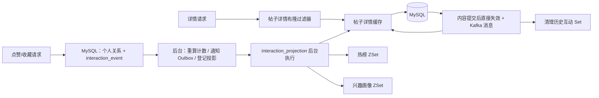

# Redis 缓存与数据结构说明

> 依据当前工作区 `forum-server` 源码整理。下文的 `{postId}`、`{userId}`、`{categoryId}` 是十进制 ID 占位符；`StringRedisTemplate` 将 key 和普通成员按字符串处理。Redis 连接默认 `localhost:6379`、DB 0，可通过 `REDIS_HOST`、`REDIS_PORT`、`REDIS_PASSWORD`、`REDIS_DATABASE`、`REDIS_TIMEOUT` 配置。配置入口见 [application.yml](../forum/forum-server/src/main/resources/application.yml)。

核对日期：2026-10-10。本文描述源码中的 key 模式及生命周期，未读取实际 Redis 实例。MySQL 的 16 张业务/支撑表及 V8 迁移见 [数据库说明](DATABASE_SCHEMA.md)。

## 先看整体关系

MySQL 保存帖子、点赞、收藏、评论等业务数据；Redis 负责加速详情读取、无效帖子 ID 过滤，以及保存热榜和兴趣画像。这里直接使用 `StringRedisTemplate`，没有使用 Spring `@Cacheable`。V8 点赞/收藏请求只提交个人关系与持久化事件，后台再更新计数、详情缓存、热榜和画像。Kafka 的**帖子缓存失效消息**负责触发详情版本更换及 key 删除，`evict_all` 还清理历史互动缓存；Kafka 消息本身不是 Redis 的 key/value。



## Key 总表

共 17 种 key 模式，其中 4 种点赞/收藏 Set/init 为历史遗留，当前代码只保留删除路径；不能据此读取当前互动状态。

| Key（默认值） | Redis 类型与 value | 用途 | 过期与删除 |
| --- | --- | --- | --- |
| `forum:post:detail:{postId}` | String；`{"data": PostDetailVO, "expireAtMillis": 毫秒时间戳}` JSON | 缓存帖子详情 | 逻辑过期默认 600～720 秒；物理 TTL 再多 300 秒。帖子变化时失效 |
| `forum:post:detail:lock:{postId}` | String；`"1"` | 一个请求获得详情重建资格 | `SET NX`，默认 10 秒；重建结束删除；失效不删除重建锁 |
| `forum:post:like:users:{postId}` | Set；点赞用户 ID 的字符串集合 | 历史遗留；当前请求不读写此 Set | 无 TTL；删除帖子时清理；空集合不一定存在实体 key |
| `forum:post:like:init:{postId}` | String；`"1"` | 历史遗留初始化标记；当前请求不读写 | 无 TTL；删除帖子时清理 |
| `forum:post:favorite:users:{postId}` | Set；收藏用户 ID 的字符串集合 | 历史遗留；当前请求不读写此 Set | 无 TTL；删除帖子时清理；空集合不一定存在实体 key |
| `forum:post:favorite:init:{postId}` | String；`"1"` | 历史遗留初始化标记；当前请求不读写 | 无 TTL；删除帖子时清理 |
| `forum:post:bloom` | String 位图；指定 bit 为 0 或 1，不保存原始帖子 ID | 详情查询前过滤明显不存在的 ID | 无 TTL；启动时加载正常帖子、新建/恢复帖子时置位；不清除旧 bit。key 可配置 |
| `forum:post:bloom:ready` | String；`"1"` | 标记布隆过滤器预热完成 | 无 TTL；名字跟随位图 key 配置变化 |
| `forum:distribution:hot:24h:all` | ZSet；成员=帖子 ID 字符串，score=热度分 | 全站近 24 小时热榜 | 写入时刷新 26 小时 TTL；后台按帖子重算；不再清空整个榜 |
| `forum:distribution:hot:24h:category:{categoryId}` | ZSet；成员=帖子 ID 字符串，score=热度分 | 分类近 24 小时热榜 | 写入时刷新 26 小时 TTL；后台按帖子重算或移除失效成员 |
| `forum:distribution:hot:keys` | Set；成员=热榜 ZSet 的完整 key 名 | 找出旧分类榜并清理成员 | 写入全站榜时刷新 26 小时 TTL；逐次登记，不整表重写 |
| `forum:distribution:hot:rebuild:lock` | String；随机 UUID | 限制多个进程同时登记每小时热榜任务 | `SET NX`，5 分钟 TTL；任务结束检查 UUID 后删除 |
| `forum:distribution:interest:tag:{userId}` | ZSet；成员=标签 ID 字符串，score=兴趣权重 | 用户标签兴趣、个性化推荐 | 写入时刷新 90 天 TTL；重建时原子替换 |
| `forum:distribution:interest:category:{userId}` | ZSet；成员=分类 ID 字符串，score=兴趣权重 | 用户分类兴趣、个性化推荐 | 写入时刷新 90 天 TTL；重建时原子替换 |
| `forum:distribution:interest:ready:{userId}` | String；`"1"` | 标记该用户画像已建立，包括空画像 | 每次建立或更新时设置 90 天 TTL |
| `forum:post:detail:version:{postId}` | String；随机 UUID；缺失时读取端按 `"0"` 比较 | 失效旧详情查询的回填资格 | 无 TTL；失效时更换；不可单独删除版本 |
| `forum:distribution:interest:version:{userId}` | String；数据库投影任务的修订号 | Lua 拒绝旧画像快照覆盖新结果 | 无 TTL；与数据库任务修订一同维护 |

表中的“无 TTL”表示代码未调用 `EXPIRE` 或带过期时间的 `SET`，并非 Redis 永远不会因运维操作或内存策略丢失该 key。下面按实际调用顺序解释。

## 1. 帖子详情：String JSON + 短锁

入口是 [`PostServiceImpl.getPostDetail`](../forum/forum-server/src/main/java/com/forum/server/service/impl/PostServiceImpl.java)：先用布隆过滤器判断 ID，再给数据库浏览数加 1、登记 POST 投影任务，然后读取 `forum:post:detail:{postId}`。热榜刷新不是请求中直接写 Redis；即使详情命中，仍有浏览计数、任务登记及登录用户互动状态等 MySQL 操作。

缓存 value 是一个 JSON 包装对象，例如：

```json
{
  "data": {"id": 42, "title": "示例帖子", "viewCount": 10, "isLiked": false, "isFavorited": false},
  "expireAtMillis": 1790000000000
}
```

`data` 是完整 `PostDetailVO`；示例仅展示部分字段。实际还包括正文、作者、分类、标签、计数、地点和时间等，字段定义见 [`PostDetailVO`](../forum/forum-pojo/src/main/java/com/forum/pojo/vo/PostDetailVO.java)。`expireAtMillis` 是**业务逻辑过期**时间，不是 Redis `TTL`。默认逻辑 TTL 为 600 秒加随机 0～120 秒，物理 TTL 再加 300 秒。因此逻辑过期后 key 仍可短暂读到旧值。

`root.has("data") && root.has("expireAtMillis")` 只识别包装结构；是否逻辑过期由 `System.currentTimeMillis() >= expireAtMillis` 判断。旧版直接序列化的 `PostDetailVO` 仍能读取，会被视为未逻辑过期，直到物理 TTL 到期或被失效。

- **命中且未逻辑过期**：返回缓存。代码会把返回对象的 `viewCount` 加 1，但不会将这个新值写回 Redis；连续命中时展示值可能落后于 MySQL。
- **命中但已逻辑过期**：先返回旧值，同时尝试创建 `forum:post:detail:lock:{postId}`；获得锁的请求通过 `CompletableFuture.runAsync` 查 MySQL 并重写缓存，其余请求继续拿旧值。
- **缓存缺失、JSON 解析失败或 Redis 异常**：查 MySQL，组装 `PostDetailVO`，再尝试写缓存。不存在或隐藏的帖子会删除详情 key 并返回不存在；没有写“空值”或不存在占位符。
- **用户自己的点赞/收藏状态**：缓存写入前置为 `false`，响应前通过 MySQL 的点赞/收藏表按当前用户查询并填入，不把某个用户的状态作为公共详情缓存长期共享。

缓存缺失和异步重建都在查 MySQL **之前**读取版本，缺失版本按 `"0"` 处理，Redis 读取版本失败则跳过回填。查库完成后 Lua 在一次操作中比较当前版本并写入详情及物理 TTL：版本变化即拒绝旧查询的回填。失效 Lua 则原子更换 UUID 并删除详情，避免“先删除、旧查询又写回”的竞争。

内容变化在提交后直接尝试失效，再异步发送 Kafka；消费者更换详情版本并删除详情 key，不删除重建锁。互动计数完成后通过持久化投影任务失效详情。删除帖子发送 `evict_all`，还会删除对应点赞/收藏 Set 及初始化标记。源码见 [`PostDetailCacheService`](../forum/forum-server/src/main/java/com/forum/server/service/cache/PostDetailCacheService.java)、[`PostCacheInvalidationEventPublisher`](../forum/forum-server/src/main/java/com/forum/server/messaging/PostCacheInvalidationEventPublisher.java)、[`PostCacheInvalidationEventConsumer`](../forum/forum-server/src/main/java/com/forum/server/messaging/PostCacheInvalidationEventConsumer.java)。

**边界**：提交后回调先直接失效，再异步发送 Kafka，这条缓存消息没有写入数据库 Outbox。进程若在提交后、回调执行前退出，直接失效也可能遗漏；已有持久化 POST 任务会补充失效。若直接失效已执行而 Kafka 尚未发送，直接失效仍然有效。后台使用 `evictStrict`，Redis 异常会让任务保持未完成并重试；普通 `evict` 只记录异常。

重建锁只覆盖“命中旧值但逻辑过期”的异步重建，**缓存缺失路径没有该锁**。因此后台主动删除热点详情后，多个请求仍可能同时回源 MySQL；版本比较防止失效前旧查询回填，但不合并并发查库。详情锁的 value 固定为 `"1"`，释放时直接 `DEL`，没有校验持有者；超过 10 秒后旧任务可能删除后来取得的新锁。

浏览数也不是缓存中的实时总数：请求先更新 MySQL，命中时在缓存副本上再加 1；缺失路径查到更新后的数据库值后仍对返回对象加 1，再写缓存。当前实现的展示值可能滞后或暂时高于数据库，不能把它当成精确计数保证。

## 2. 点赞与收藏：MySQL 关系与持久化事件

当前请求不初始化、不切换 Redis Set。明确设置状态时，个人关系和 `interaction_event` 一起提交，后台重算计数并登记 `interaction_projection`。Redis 故障不影响关系与事件提交；投影失败保留任务并重试。上表四个 Set/init key 仅为历史数据，由 `PostInteractionCacheService` 的旧缓存清理路径删除，不能用于查询当前状态或计数。

新请求使用 `PUT /api/interactions/posts/{id}/like`、`PUT /api/interactions/posts/{id}/favorite` 和 `PUT /api/interactions/comments/{id}/like`，请求体明确指定 `active`。返回值是本次提交后的个人状态，重复设置同一状态不生成新事件。后台计数从关系表重算绝对值，不使用 Redis `SCARD` 或事件 `+1/-1` 作为最终计数。

删除帖子发送的 `evict_all` 会尝试删除四个历史 key；新持久化 POST 投影只处理详情和热榜，不负责可靠清理历史 Set。因此遗留 key 清理失败不会影响当前业务状态，但也不保证由投影任务自动回收。代码见 [PostInteractionCacheService](../forum/forum-server/src/main/java/com/forum/server/service/cache/PostInteractionCacheService.java)，实现和边界见 [互动最终一致性](../forum/INTERACTION_CONSISTENCY.md)。

## 3. 帖子存在性：Redis 位图布隆过滤器

[`PostBloomFilterService`](../forum/forum-server/src/main/java/com/forum/server/service/cache/PostBloomFilterService.java) 启动时查询 MySQL 中 `status=1` 的帖子 ID。每个 ID 用 7 个种子求哈希，并对默认 1,048,576 个 bit 中相应位置执行 `SETBIT 1`；完成后写 `forum:post:bloom:ready="1"`。新增帖子和管理员恢复正常状态时也会置位。位图 key、bit 数、哈希数可通过 `POST_BLOOM_FILTER_KEY`、`POST_BLOOM_FILTER_BIT_SIZE`、`POST_BLOOM_FILTER_HASH_COUNT` 调整。

读取详情时，若 `ready` 不存在或 Redis 查询报错，则返回“可能存在”，继续走详情缓存/MySQL；只有 `ready` 存在且任意一个 bit 为 0，才直接判断 ID 不存在。所有 bit 都为 1 只是“可能存在”，仍要查缓存或数据库确认。删除或隐藏帖子时不会清除 bit，所以旧 ID 可能继续通过过滤器；这是布隆过滤器允许的假阳性。

**边界**：位图与 `ready` 没有 TTL，启动加载是累加置位，没有先清空旧位图。若只丢失位图而 `ready` 留存、创建帖子事务回滚但 bit 已置位，或调整 bit 数/哈希数却复用旧 key，过滤结果可能失真。特别是 `ready` 存在而位图缺失时，`GETBIT` 会读出 0，有误判真实帖子为不存在的风险。

`add` 内部捕获 Redis 写入异常；启动加载也可能在部分置位失败后仍写入 ready，所以“ready 存在”不证明全部 ID 已成功加载。位图与 ready 的恢复由启动预热和新建/恢复帖子调用负责，POST 投影不会重建布隆过滤器。

## 4. 热榜：全站/分类 ZSet 与持久化刷新

`ContentRankingService` 依据近 24 小时可见帖子的浏览/点赞/评论/收藏和时间衰减重算分数。刷新调用登记 POST 投影任务；后台更新全站/分类 ZSet、移除失效或过期帖子，并清理旧分类成员。正常 ZSet/注册表 TTL 为 26 小时。

分数计算如下，年龄按分钟换算成小时，最低为 0：

```text
engagement = view_count × 0.2 + like_count × 2 + comment_count × 3 + favorite_count × 4
score = (engagement + 1) × exp(-ageHours / 12)
```

`refreshStrict` 先读取 MySQL 帖子及 `hot:keys` 注册表，清除该帖子在旧分类的成员；不存在、隐藏或创建超过 24 小时的帖子执行 `ZREM`，其余执行 `ZADD` 更新全站与当前分类榜，再刷新 TTL 和登记榜单 key。注册表可能包含已过期分类 key；清理成员不会删除注册表项。

每小时任务仍用 UUID Redis 锁（5 分钟 TTL）协调登记工作，但不再清空/重写榜单。它将当前近 24 小时帖子及旧榜成员交给相同的持久化队列处理。数据库后台锁协调多个实例执行投影。ZSet 刷新不是与 MySQL 提交一起完成，允许短暂延迟；错误会保留任务并重试。

具体而言，每小时任务合并 MySQL 正常的近 24 小时帖子与**旧全站榜**成员，然后登记任务；它没有扫描全部旧分类榜成员。锁释放先 `GET` 比较 UUID 再 `DEL`，不是原子的 Lua 比较删除。单帖子刷新包含多条 Redis 命令，全站榜、分类榜和注册表也不是一起原子更新；中途失败可留下部分结果，持久化任务重试后补齐。

热榜查询的 Redis 异常被转换为空 ID 列表。当前帖子热榜列表路径仍查询 MySQL 正常的近 24 小时帖子：置顶优先，置顶之间按创建时间倒序；非置顶先按 Redis 名次，再按源码中的 `hotScore` 和创建时间倒序。空榜时非置顶帖子按数据库字段计算的分数排序，因此仍可返回结果。源码见 [ContentRankingService](../forum/forum-server/src/main/java/com/forum/server/service/distribution/ContentRankingService.java) 和 [PostServiceImpl](../forum/forum-server/src/main/java/com/forum/server/service/impl/PostServiceImpl.java)。

## 5. 兴趣画像：90 天有效关系与原子快照

当前画像由近期仍存在的帖子点赞（2）、收藏（4）和有效评论（3）重算，并过滤不可见帖子。评论点赞不增加画像权重。状态变化登记 USER 投影任务；后台以 Lua 原子替换标签 ZSet、分类 ZSet、ready 和版本，重复处理不会重复加权，较旧修订不能覆盖新快照。

90 天窗口分别使用点赞/收藏关系的 `created_at` 和正常评论的 `created_at`。同一帖子可同时累计点赞 2、收藏 4 和每条有效评论 3，再将总权重加到其分类及每个标签。例如点赞并收藏一个带两个标签的帖子，分类和两个标签各得到 6 分；取消收藏后的重建各降为 2 分。不是根据事件数量累计，也不是把权重平分到标签。

标签/分类 ZSet 和 ready 在重建后设置 90 天 TTL；空画像只有 ready/version，两个 ZSet 可以不存在。版本 key 不设置 TTL，数据库投影行也保留，不能单独重置其中一方。

读取时只要 ready 存在，**或者任一 ZSet 读出非空画像**，就使用 Redis 结果；只有 ready 缺失且两类画像均为空，或 Redis 读取异常，才登记 USER 任务并同步返回 MySQL 计算结果。读取侧不写 Redis，命中也不延长 TTL。单独删除 ready 不保证触发重建；单独删除某个 ZSet 而保留 ready 可能返回残缺画像。空画像有 ready/version，两个 ZSet 不存在是正常情况。

Lua 仅在 Redis 已有版本大于待写修订时拒绝写入，同版本重试仍可替换快照。Redis 写入完成后数据库确认失败时，可重新执行该任务；若数据库投影版本被单独重置而 Redis 版本更大，旧修订会被拒绝，不能靠反复重试解决版本失配。

90 天是数据库查询窗口和快照 TTL，没有逐条定时扣除机制，无新任务时窗口变化需等待后续重建。Redis 不可用时数据库任务保留；画像获取兜底还依赖 MySQL 查询和任务登记成功。源码见 [UserInterestService](../forum/forum-server/src/main/java/com/forum/server/service/distribution/UserInterestService.java)。

## 6. 后台触发与恢复范围

| 触发 | 数据库动作 | Redis 动作与恢复 |
| --- | --- | --- |
| 点赞/收藏实际变化 | 请求提交关系与事件；每秒后台批量重算计数、登记 POST/USER | 每秒投影任务更新详情版本并删除详情、刷新热榜、原子重建画像 |
| 发帖、编辑、隐藏/恢复、删除及评论变化 | 相应业务路径登记 POST/USER；内容变更还登记已有互动用户 | 持久化任务更新派生结果；原有提交后直接失效/Kafka 路径仍保留 |
| 详情读取 | MySQL 浏览数加 1，登记 POST | 当前请求读详情，缺失回填或逻辑过期异步重建；后台还会失效该帖详情并刷新热榜 |
| 每小时热榜任务 | 获得 Redis 锁后登记 POST | 同一后台刷新路径处理时间衰减与旧成员 |
| 画像无法从缓存取得 | 登记 USER，并按 MySQL 当前关系计算响应 | 后台写入完整快照；读取侧不直接写缓存 |
| 孤立关系清理 | 每 60 秒分批删除目标不存在的互动，登记受影响 USER | 后台重建画像 |

事件与投影默认每轮最多 500 条，失败按指数退避重试，最大间隔 60 秒。POST 任务先 `evictStrict` 再 `refreshStrict`，后一步失败时重试会再次失效详情；USER 任务调用 `rebuildStrict`。后台在 Redis 操作期间持有 MySQL 投影协调锁和任务行锁，之后才写完成标记，两个系统没有共同的原子提交。代码见 [InteractionWorker](../forum/forum-server/src/main/java/com/forum/server/service/distribution/InteractionWorker.java)。

已完成的投影行不会因为 Redis key 被运维删除而自动变成 pending。热榜可由后续浏览/内容变化或每小时任务补建；画像在满足缺失条件的读取或后续互动时补建；详情在后续请求中回填；布隆位图由启动预热补建。版本 key 和数据库投影行需要配套维护，避免进行中的旧查询或旧修订重新获得写入资格。

## 排查时按这个顺序看

1. 先确认 MySQL 里的帖子、互动行与计数字段；Redis 的详情、热榜和画像都依赖这些源数据。
2. 用 `TYPE <key>`、`TTL <key>` 看类型和剩余寿命；用 `GET` 看 String、`SMEMBERS`/`SCARD` 看 Set、`ZREVRANGE <key> 0 -1 WITHSCORES` 看 ZSet、`GETBIT` 看位图。不要对生产环境的大集合随意执行全量读取。
3. 对详情问题检查 JSON 里的 `expireAtMillis` 与 Redis `TTL`，两者含义不同；对点赞/收藏检查 MySQL 关系和未处理事件；对画像检查 `ready` 与两个 ZSet 是否配套；对布隆过滤器检查 `ready` 与位图是否同时存在。
4. 再追踪业务调用、事务提交后的动作以及 Kafka 缓存失效消息。检查 interaction_event 和 interaction_projection 的积压、修订及 last_error；互动后的 Redis 投影由持久化任务恢复，通知继续经过 Outbox/Kafka。
