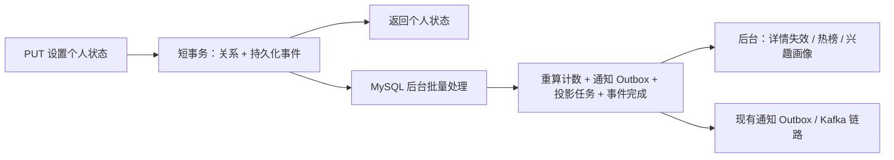

# 点赞、收藏的最终一致性

## 请求与异步处理

帖子点赞、评论点赞、帖子收藏统一使用 `PUT /api/interactions/posts/{id}/like`、`PUT /api/interactions/comments/{id}/like`、`PUT /api/interactions/posts/{id}/favorite`，请求体为 `{"active":true}` 或 `{"active":false}`。返回的 Boolean 是本次操作完成后的个人状态。重复设置同一状态不生成新事件；相反状态的并发请求按数据库实际执行顺序处理。

`InteractionServiceImpl` 使用 READ COMMITTED 短事务，普通查询检查帖子及评论的可见性，只对当前个人关系执行当前读与必要的行锁。发生变化时，关系插入/删除与 `interaction_event` 插入一起提交。唯一键竞争和瞬态数据库故障会回滚整个事务，再最多重试三次。接口成功表示关系已持久化，不表示总数、通知或 Redis 已更新。

请求不锁 `post` 或 `comment` 行，不修改其点赞/收藏计数，不调用 Redis/Kafka。数据库写入仍有内部锁；相同个人关系仍可能竞争。



## 后台与故障恢复

`InteractionWorker` 每秒扫描至多 500 条事件，并按帖子、评论、用户合并。后台协调表的 `counts` 行锁串行化不同 JVM 的计数批次，请求不访问这张表。计数从真实关系表重算，以绝对值写入；计数、通知 Outbox、投影任务登记及事件完成标记在同一事务内提交。批次失败会整体回滚，重复执行不会重复计数或生成通知。

正常新增关系在处理时检查内容可见性，再生成通知；取消、自赞以及处理时已经失效的目标不新增通知。真实的点赞后取消仍是两个状态变化，已经发生的点赞事件可以产生一条通知。Kafka 发送成功、通知消费和用户阅读仍是不同阶段。

`interaction_projection` 按 POST/USER 合并，保留递增 revision 和 completed_revision。每秒最多处理 500 个任务；执行期间持有任务行锁，后来登记的修订在完成后递增，避免丢失。Redis 操作明确报错才会重试，不能把异常吞掉后确认成功。计数扫描与投影执行使用独立协调锁；定时调度线程池为 4。

热榜的互动刷新、内容变化和每小时衰减都进入同一持久化队列，不再并发清空/重写整个榜。兴趣画像按当前有效关系和既有 90 天窗口重建，权重为帖子点赞 2、收藏 4、评论 3；评论点赞仍不增加推荐权重。Lua 原子替换标签、分类、ready 和版本，拒绝旧版本覆盖；重复重建不重复加权。读取画像缺失时返回数据库计算结果并登记重建任务，读取侧不直接写 Redis。

事件/投影失败保留记录，以指数退避重试，最大间隔 60 秒。恢复后自动追平；日志报告失败、队列数量、最老任务时间、累计重试，以及超过 5 秒的积压。事件表保留处理历史，投影表保留版本；上线后需根据实际规模制定处理历史归档策略，不能删除未完成记录或单独重置画像版本。

## 内容变更与缓存边界

隐藏或删除和互动允许短暂竞争。不存在的目标所留下的关系由事件处理及每分钟的分批孤立关系清理任务移除，受影响用户重新计算画像。隐藏内容保留历史关系，但不能继续提交新互动，不参与推荐；恢复后重新投影。收藏列表过滤不存在或不可见的帖子。

编辑、管理和评论隐藏只写对应字段，不用旧实体覆盖后台计数。帖子编辑、隐藏、恢复、删除会登记持久化投影任务；发表评论/删除评论也通过持久化热榜与用户任务更新派生数据。

公共详情缓存不保存个人状态，响应时从关系表补齐。后台计数成功后，投影任务更新详情版本并删除缓存，阻止失效前的旧查询回填；不会删除正在使用的重建锁。内容变更原有的提交后直接失效/Kafka 链路仍保留，并由新增持久化投影任务补充恢复路径。缓存在异步刷新前允许展示旧计数。

前端在请求期间禁用对应按钮，只在个人状态改变时修正本地估算总数，最低为零；网络故障自动重试一次原目标状态，之后读取以后台计数为准。

## 迁移与运行

Flyway `V8__async_interactions.sql` 新增事件表、投影任务表、后台协调表和按目标统计的关系索引，并按已有关系校准计数、初始化投影任务，不补发历史通知。V8 要求已有 v6 基础结构并先应用 V7。

上线应停止旧版本写入，在维护窗口运行迁移，部署配套前后端再开放请求。旧 POST 切换接口已移除，不能混跑同步计数版本与异步计数版本。迁移会统计全部关系，大库需要预估执行时间。这里只在隔离测试数据库执行了迁移，没有修改现有业务数据库。

配置入口：`application.yml` 的 `forum.interactions`。扫描/投影默认 1000 ms，事件/投影批次默认 500，孤立关系清理默认 60000 ms；通知 Outbox 默认扫描缩短至 1000 ms。5 秒是健康环境下的目标，不是故障期间或任意负载下的保证。

## 验证（2026-10-06）

真实 MySQL 8.0.45、隔离 Redis：21 项测试通过，覆盖跨实例重复设置、相反状态竞争、事件写入回滚、后台恢复、投影重试、任务修订竞争、删除清理和实际 Lua 脚本。默认 H2 环境的 Maven 打包也已验证；H2 不代替 InnoDB 检查。

120 用户、12 线程，经 1 秒周期后台处理，实际 MySQL → Redis 热榜和全部兴趣画像在 3622 ms 内收敛。通知只验证 Outbox 持久化及现有 dispatcher 单元测试，没有启动 Kafka 做端到端消费压测。

300 用户、12 线程、同一帖子写入路径对比：旧式“锁帖子 + 同步计数”SQL 基线总耗时 2047 ms、P95 94 ms、行锁等待 299 次；新请求路径总耗时 309 ms、P95 17 ms、行锁等待 0 次。基线和新路径都写持久化事件，基线是测试中重现的 SQL 路径。该组后台投影为 mock，不用于证明 Redis/Kafka 端到端容量。

前端 `npm run build` 和 Vite 下 Chromium 浏览器检查通过；模拟 API 验证了点赞/收藏/评论点赞开启与取消、重复点击抑制、网络失败重试保留 active、非负本地计数。截图位于 `output/playwright/interaction-states.png`。Playwright、npm 缓存和浏览器安装在 `D:/biancheng/playwright`。

复现后端真实数据库测试时，只连接专用测试 MySQL；测试会创建并删除独立的 `interaction_test_*` 数据库：

```powershell
cd forum
mvn.cmd -q "-Dmaven.repo.local=D:/ShengYi/QA-PLUS/.m2/repository" `
  "-Dinteraction.test.url=jdbc:mysql://127.0.0.1:13307/" `
  "-Dinteraction.test.benchmark=true" `
  "-Dredis.test.server=D:/biancheng/redis/Redis-x64-3.0.504/redis-server.exe" `
  -pl forum-server -am package
```